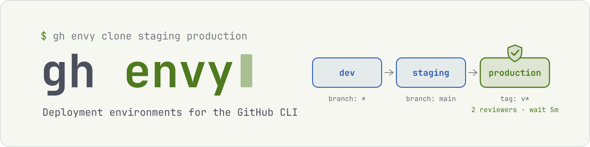
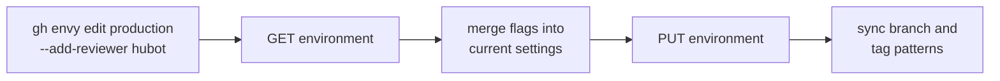

<div align="center">

<picture>
  <source media="(prefers-color-scheme: dark)" srcset="assets/banner/banner-dark.svg">
  
</picture>

Create, inspect and gate GitHub deployment environments from the terminal, then approve the runs they hold.

[![Release][release-badge]][release]
[![CI][ci-badge]][ci]
[![Go][go-badge]][go]
[![License][license-badge]][license]

---

<a href="#install"><picture><source media="(prefers-color-scheme: dark)" srcset="assets/nav/install-dark.svg"></picture></a>
<a href="#quickstart"><picture><source media="(prefers-color-scheme: dark)" srcset="assets/nav/quickstart-dark.svg"></picture></a>
<a href="#commands"><picture><source media="(prefers-color-scheme: dark)" srcset="assets/nav/commands-dark.svg"></picture></a>
<a href="docs/commands.md"><picture><source media="(prefers-color-scheme: dark)" srcset="assets/nav/docs-dark.svg"></picture></a>

---

</div>

<picture>
  <source media="(prefers-color-scheme: dark)" srcset="assets/demo/overview-dark.svg">
  
</picture>

`gh envy` is a [GitHub CLI](https://cli.github.com) extension that fills in the `gh env` command core gh still lacks. The request, [cli/cli#5149](https://github.com/cli/cli/issues/5149), has been open since 2022.

It manages a repository's deployment environments, the rules that gate them, and the runs those gates hold back:

- List and view environments, with reviewers, wait timer, allowed branches and tags, protection apps, variables and secret names
- Create and edit protection rules with flags, or with an interactive editor
- Clone an environment within a repository or to another one
- Delete environments, with a typed confirmation
- List runs waiting at an environment gate, then approve or reject them ([cli/cli#5773](https://github.com/cli/cli/issues/5773), open since 2022)
- See what was last deployed to an environment
- `--json`, `--jq` and `--template` output with the same flags as core gh

## Why gh envy?

Core gh sets an environment's secrets and variables with `gh secret set --env`, but it can't create the environment or touch its protection rules. That leaves the settings page, hand-written `gh api` calls with nested JSON bodies, or Terraform for a single repository.

| | gh envy | core gh | [chelnak/gh-environments] | [katiem0/gh-environments] | Terraform |
| --- | :---: | :---: | :---: | :---: | :---: |
| Create and delete environments | ✓ | | ✓ | create only, from CSV | ✓ |
| Set reviewers, wait timer, admin bypass | ✓ | | | on create, from CSV | ✓ |
| Branch and tag patterns | ✓ | | | on create, from CSV | ✓ |
| Protection apps | ✓ | | | | ✓ |
| Copy an environment | ✓ | | | | |
| Approve or reject waiting runs | ✓ | [cli/cli#5773] | | | |
| `--json` / `--jq` / `--template` | ✓ | | `--json` | CSV report | |
| Works without state files or config | ✓ | ✓ | ✓ | | |
| Maintained | ✓ | ✓ | last release 2022 | ✓ | ✓ |

For org-wide policy across hundreds of repositories, declarative tools like Terraform or [safe-settings](https://github.com/github/safe-settings) are the better fit. gh envy is for the repository in front of you.

## Install

You need [gh](https://cli.github.com) 2.0 or later, logged in.

```sh
gh extension install shbernal/gh-envy
```

The command is `gh envy`. Its name stays clear of `gh env`, so it keeps working if core gh adds that command later.

## Quickstart

1. In a clone of a repository you administer, list its environments:

   ```sh
   gh envy list
   ```

2. Create a production environment that needs a review, waits 30 minutes, and only deploys `main` and version tags:

   ```sh
   gh envy create production --reviewer octocat --reviewer my-org/release-managers --wait-timer 30m --branch main --tag 'v*'
   ```

3. Check what you built:

   ```sh
   gh envy view production
   ```

<picture>
  <source media="(prefers-color-scheme: dark)" srcset="assets/demo/create-dark.svg">
  
</picture>

4. Spin up a staging environment with the same rules:

   ```sh
   gh envy clone production staging
   ```

5. When a deploy workflow reaches production, see what it waits on and approve it:

   ```sh
   gh envy waiting production
   gh envy approve -w deploy.yml
   ```

<picture>
  <source media="(prefers-color-scheme: dark)" srcset="assets/demo/approve-dark.svg">
  
</picture>

## Commands

| Command | What it does |
| --- | --- |
| `gh envy list` | Environments and a summary of their protection |
| `gh envy view <env>` | One environment in full, with its last deployment and waiting runs; `--web` opens its settings |
| `gh envy create <env>` | New environment, with `--reviewer`, `--wait-timer`, `--branch`, `--tag`, `--protected-branches`, `--prevent-self-review`, `--admin-bypass`, `--secret` |
| `gh envy edit <env>` | Change only what you name; `--add-*` and `--remove-*` change sets in place |
| `gh envy clone <src> <dst>` | Copy rules, patterns, apps and variables; prints the secrets left to set |
| `gh envy delete <env>...` | Delete, after typing the name or with `--yes` |
| `gh envy protection list\|enable\|disable` | Custom deployment protection apps |
| `gh envy waiting [<env>]` | Runs held at an environment gate, and what holds them |
| `gh envy approve [<run>]` | Approve a waiting deployment; `--watch` follows the run |
| `gh envy reject [<run>]` | Reject a waiting deployment |

Every command takes `-R OWNER/REPO`. See the [command reference](docs/commands.md) for every flag and JSON field.

<picture>
  <source media="(prefers-color-scheme: dark)" srcset="assets/demo/clone-dark.svg">
  
</picture>

## How it works

gh envy uses gh's own login, host and repository detection through [go-gh](https://github.com/cli/go-gh), and calls the REST endpoints for [deployment environments](https://docs.github.com/en/rest/deployments/environments).



`edit` reads the environment first and writes back its full configuration with your changes applied, so nothing you didn't name is lost. It sends wait timers and reviewers only when they are set or being cleared, because free plans reject those fields on private repositories.

## More

- [Command reference](docs/commands.md): every flag, JSON field, and the plan and permission requirements
- [Contributing](CONTRIBUTING.md): tests, demos and releases

[cli/cli#5773]: https://github.com/cli/cli/issues/5773
[chelnak/gh-environments]: https://github.com/chelnak/gh-environments
[katiem0/gh-environments]: https://github.com/katiem0/gh-environments

[release]: https://github.com/shbernal/gh-envy/releases/latest
[release-badge]: https://img.shields.io/github/v/release/shbernal/gh-envy?style=for-the-badge&labelColor=1a1b26&color=9ece6a&logo=github&logoColor=9ece6a
[ci]: https://github.com/shbernal/gh-envy/actions/workflows/ci.yml
[ci-badge]: https://img.shields.io/github/actions/workflow/status/shbernal/gh-envy/ci.yml?branch=main&style=for-the-badge&labelColor=1a1b26&color=9ece6a&logo=githubactions&logoColor=9ece6a&label=ci
[go]: go.mod
[go-badge]: https://img.shields.io/github/go-mod/go-version/shbernal/gh-envy?style=for-the-badge&labelColor=1a1b26&color=7aa2f7&logo=go&logoColor=7aa2f7
[license]: LICENSE
[license-badge]: https://img.shields.io/github/license/shbernal/gh-envy?style=for-the-badge&labelColor=1a1b26&color=e0af68
